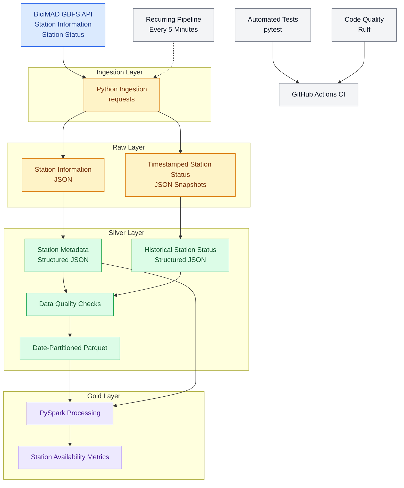

# BiciMAD Data Platform Architecture

## Overview

The platform ingests real-world bike-sharing data from the BiciMAD GBFS API and processes it through Raw, Silver and Gold layers to produce station-level availability metrics.

## Architecture Diagram

## Data Layers

| Layer | Purpose | Output |
|---|---|---|
| Raw | Preserve source data and historical snapshots | JSON |
| Silver | Structure, validate and prepare data for analysis | JSON and partitioned Parquet |
| Gold | Calculate station-level availability metrics | Analytical dataset |

## Processing

1. Retrieve station information and current station status from the BiciMAD GBFS API.
2. Store station metadata and timestamped status snapshots in the Raw layer.
3. Transform source data into structured Silver datasets.
4. Validate data quality before continuing the pipeline.
5. Convert historical station-status records into date-partitioned Parquet files.
6. Use PySpark to calculate station-level availability metrics.
7. Repeat the pipeline every five minutes and log execution failures.

## Quality and Continuous Integration

The project includes automated data quality checks, unit tests with pytest and code quality checks with Ruff. GitHub Actions executes the tests and lint checks on pushes and pull requests targeting the `main` branch.

## Future Extensions

Potential improvements include a dashboard for historical mobility analysis, additional transport data sources, cloud storage and querying, and natural-language analytics.