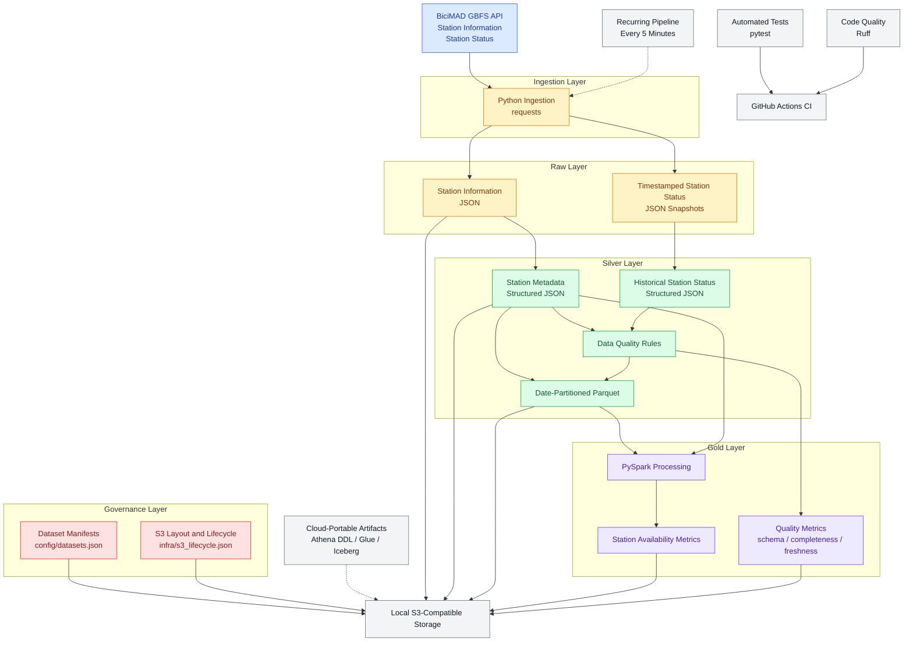

# BiciMAD Data Platform Architecture

## Overview

The platform ingests real-world bike-sharing data from the BiciMAD GBFS API and processes it through Raw, Silver and Gold layers to produce station-level availability metrics.

A governance layer describes every dataset, validates its schema, measures completeness and freshness, and publishes quality metrics alongside the analytical data. Cloud-portable artifacts for Amazon S3, AWS Glue Data Catalog, Amazon Athena and Apache Iceberg are provided and validated locally without deploying paid AWS services.

## Architecture Diagram

## Data Layers

| Layer | Purpose | Output |
|---|---|---|
| Raw | Preserve source data and historical snapshots | JSON |
| Silver | Structure, validate and prepare data for analysis | JSON and partitioned Parquet |
| Gold | Calculate station-level availability metrics and quality metrics | Analytical Parquet and JSON |
| Governance | Describe, validate and monitor every dataset | JSON manifests and Parquet metrics |

## Processing

1. Retrieve station information and current station status from the BiciMAD GBFS API.
2. Store station metadata and timestamped status snapshots in the Raw layer.
3. Transform source data into structured Silver datasets.
4. Validate data quality before continuing the pipeline.
5. Compute schema, completeness and freshness metrics for the Silver dataset.
6. Convert station metadata and historical station-status records to Parquet.
7. Use PySpark to calculate station-level availability metrics.
8. Upload datasets, quality metrics and manifests to the S3-compatible storage.
9. Repeat the pipeline every five minutes and log execution failures.

## Data Governance

`config/datasets.json` defines the dataset catalogue: layer, path, format, source, schema version, freshness SLA, partitions and tags.

`governance/dataset_metadata.py` enriches that definition with live statistics (row count, columns, partitions, size) and writes:

- `data/_metadata/<dataset>.json`
- `data/_metadata/catalog.json`
- `_metadata/<dataset>.json` in the S3-compatible storage

`governance/quality_metrics.py` produces:

- `quality_metrics_<timestamp>.json` (history)
- `latest.json`
- `quality_summary.parquet`
- `column_completeness.parquet`
- `rule_issues.parquet`

The quality gate passes only when there are no rule issues, no schema problems and the dataset is within its freshness SLA.

## Cloud-Portable Artifacts

| Artifact | Location |
|---|---|
| S3 layout, naming and tagging | `docs/s3_layout.md`, `config/datasets.json` |
| S3 lifecycle policy | `infra/s3_lifecycle.json` |
| Glue/Athena DDL | `sql/athena/*.sql` |
| Athena query guide | `docs/athena_queries.md` |
| Iceberg design | `docs/iceberg_design.md` |
| Local Iceberg example | `spark/iceberg_write_example.py` |
| Local DuckDB validation | `sql/duckdb/station_queries.sql` |

These artifacts are not deployed to AWS by the local pipeline. They document and validate the target cloud architecture for free.

## Quality and Continuous Integration

The project includes automated data quality checks, extended quality metrics, unit tests with pytest and code quality checks with Ruff. GitHub Actions executes the tests and lint checks on pushes and pull requests targeting the `main` branch.

See `docs/data_quality.md` for the full list of checks and metrics.

## Future Extensions

Potential improvements include a dashboard for historical mobility analysis, additional transport data sources, an end-to-end deployment of the cloud artifacts, and natural-language analytics.
